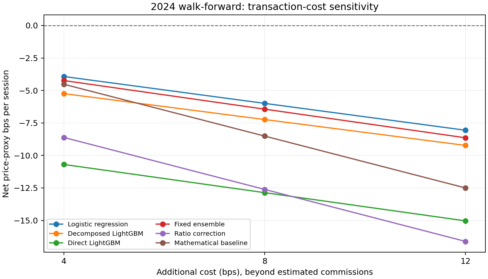
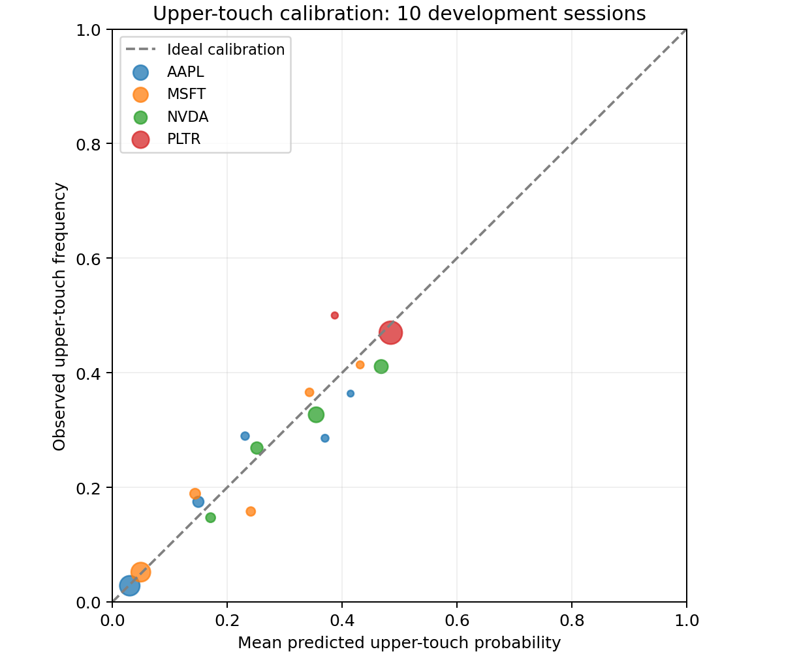

# Quantitative Research: Stochastic Modeling and Market Analysis

Independent quantitative research on intraday financial forecasting, stochastic price models, and the statistical and economic evaluation of trading hypotheses. The repository combines mathematical modeling, numerical computation, machine learning, and historical U.S. equity data infrastructure.

**Research only.** This is not a production trading system, investment recommendation, or claim of live profitability.

## Key contributions

- **Analytical probability:** finite-horizon Brownian first-passage probabilities for two absorbing barriers, using the method of images and a Fourier eigenfunction expansion; supports zero-log-drift and price-martingale conventions.
- **Statistical learning:** rolling volatility and intraday variance seasonality, regularized regression and LightGBM competing-risks forecasts.
- **Experimental design:** chronological walk-forward evaluation, leakage-aware label purging, historical-frequency benchmarks, Brier score, log loss, calibration diagnostics and session-block bootstrap intervals.
- **Data infrastructure:** versioned historical OHLCV data, security identity resolution, explicit information-availability constraints and immutable research outputs.
- **Economic evaluation:** transaction-cost sensitivity, execution-aware return proxies, portfolio constraints and corporate-action reconciliation.

## Quick start: no market data required

The analytical solver uses only the Python standard library. From the repository root, with Python 3.13 and [uv](https://docs.astral.sh/uv/) installed:

```bash
uv run --no-project --python 3.13 python -c "import sys, runpy; sys.path.insert(0, 'src'); runpy.run_path('examples/first_passage_demo.py', run_name='__main__')"
```

For the complete research environment and test suite:

```bash
uv sync --locked
uv run --locked python examples/first_passage_demo.py
uv run --locked pytest tests/unit/test_first_passage.py tests/unit/test_first_passage_drift.py
```

The example evaluates the probability of hitting an upper or lower 0.5% price barrier first, or hitting neither, with constant log-return volatility of 0.1% per square-root minute and a price-martingale drift convention. These are theoretical probabilities, not estimated market performance.

| Horizon (min) | Upper first | Lower first | Neither |
| ---: | ---: | ---: | ---: |
| 5 | 0.025650 | 0.025045 | 0.949305 |
| 15 | 0.197225 | 0.195966 | 0.606809 |
| 30 | 0.355498 | 0.354787 | 0.289715 |
| 60 | 0.467121 | 0.466956 | 0.065922 |

## Selected empirical results

**Development data only; not independent holdout evidence.** A cross-sectional
three-outcome barrier forecasting experiment evaluated 42,528 predictions
per model across 247 sessions (January 2–December 23, 2024), using 13
expanding chronological folds and a one-session embargo. The target is
upper +0.5%, lower −2.0%, or neither within 60 minutes of the entry.

| Model | Brier score ↓ | Log loss ↓ | Relative Brier reduction |
| --- | ---: | ---: | ---: |
| Logistic regression | 0.14974 | 0.69704 | 21.66% |
| Decomposed LightGBM | 0.15040 | 0.70163 | 21.31% |
| Direct LightGBM | 0.15050 | 0.70192 | 21.26% |
| Fixed ensemble | 0.15653 | 0.72808 | 18.11% |
| Ratio correction | 0.18503 | 0.98392 | 3.19% |
| Mathematical baseline | 0.19113 | 0.97332 | 0.00% |

Regularized logistic regression achieved the lowest Brier score and log loss
among the six tested models, reducing Brier score by approximately 21.7%
relative to the analytical baseline (morning realized volatility, not the
full seasonal M2.5 model). This did not translate into positive net price
proxies at any of the tested additional cost levels.



A separate four-instrument analytical validation study illustrates upper-touch
calibration using price-martingale drift and seasonal close-based volatility,
symmetric 0.2% barriers, and a five-minute horizon. It covers ten development
sessions, December 10–23, 2024. Marker size increases with bin count.



An additional [instrument-identity and corporate-action audit](docs/p5_a_3_reference_action_reconciliation.md)
found that the original +102.43 bps log-return proxy per entry session
contrasted with a −0.20 bps arithmetic proxy per original entry session
after retrospective reconciliation of the verified common-stock subset.
This is a diagnostic, not an apples-to-apples strategy comparison or a
corrected backtest.

See [detailed empirical results](results/README.md) for assumptions,
uncertainty, limitations, and aggregate figure inputs. No raw data,
individual trades, or predictions are distributed in the results section.

## Mathematical and experimental methodology

For log price `X(t) = log(P(t)/P(0)) = mu*t + sigma*W(t)`, the upper and lower barriers are `log(1 + upper_pct)` and `log(1 - lower_pct)`. The model computes mutually exclusive continuous-time first-touch outcomes over a finite horizon. Zero log drift sets `mu = 0`; the price-martingale convention sets `mu = -sigma^2/2`. Both numerical representations solve the same absorbing-boundary diffusion problem.

- [First-passage model](docs/first_passage_model.md), [validation](docs/first_passage_m25_validation.md) and [volatility seasonality](docs/first_passage_seasonality.md).
- [Cross-sectional ML barrier forecasting](docs/p6_ml_barrier_research.md): analytical, logistic-regression and LightGBM comparisons using expanding chronological folds and a one-session embargo.
- [Conditional residual research](docs/p5_conditional_residual_research.md) and [directional return experiments](docs/p4_directional_return_research.md).
- [Security master](docs/data/security_master.md) and [data storage](docs/data/storage.md).

## Historical data and reproduction

Historical experiments use version-pinned Massive minute data under `data/dev/` and pinned receipts (for example, `data/dev/minute_training_receipt_20250113.json`). These local inputs are excluded from Git. Reproduction requires the appropriate data access and original input receipts, not just the source code. REST and flat-file S3 credentials are separate; see `.env.example` and [credential configuration](docs/p4_4_1_massive_s3_credentials.md). Never commit `.env`, raw vendor data or private strategy files.

For a configured historical environment, an example validation command is:

```bash
uv run --locked python scripts/validate_first_passage.py \
    --ticker AAPL --per-scenario-stride \
    --volatility-method close --volatility-method seasonal_close \
    --scenario 0.002,0.002,5 \
    --output-dir data/dev/models/AAPL_validation_example
```

Training-only seasonality estimation, chronological splits and protected holdout procedures are documented in the linked research notes. Do not use the reserved holdout to tune models or treat January 13, 2025 engineering diagnostics as independent validation. Replays refuse to overwrite existing output directories.

## Limitations

The diffusion model assumes continuous paths and constant volatility within a forecast. It excludes jumps; observed minute OHLC bars do not reveal intrabar ordering or guarantee fills. Statistical calibration improvements do not imply positive expected trading returns. Historical vendor snapshots are not authenticated contemporaneous publications; corporate actions, delistings, missing bars and execution costs can bias empirical results. Repeated development hypotheses are not independent evidence. No claim of validated alpha or live execution performance is made.

## Repository structure

| Directory | Purpose |
| --- | --- |
| `src/quant_research/model/` | First-passage mathematics, volatility and research models |
| `src/quant_research/data/` | Historical data ingestion and storage |
| `src/quant_research/security_master/` | Historical security identities |
| `scripts/` | Research and audit entry points |
| `tests/` | Automated regression and integration checks |
| `examples/` | Data-independent demonstrations |
| `docs/` | Mathematical methodology and historical research notes |

## Development checks

```bash
uv run --locked ruff check .
uv run --locked ruff format --check .
uv run --locked mypy src/quant_research
uv run --locked pytest
```
