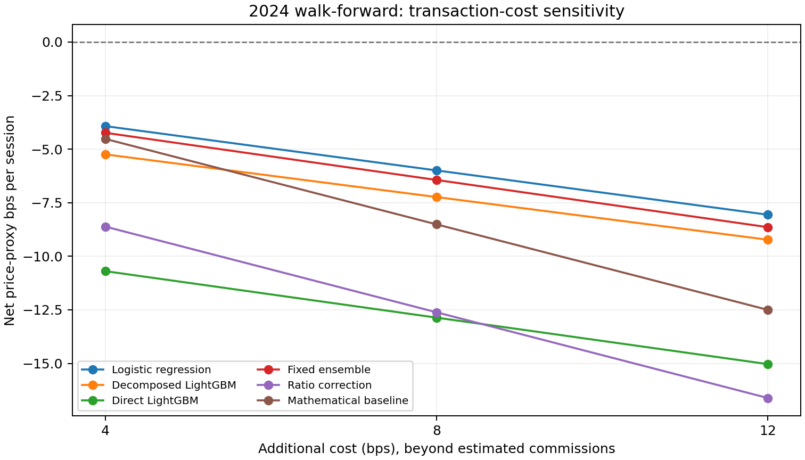
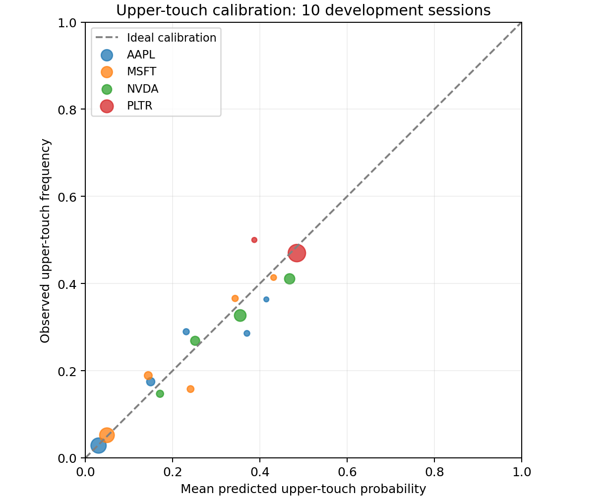

# Selected research results

## Analytical demonstration (reproducible without data)

Run `uv run --locked python examples/first_passage_demo.py` after installing the locked environment. The table below is computed by the repository's analytical solver. It is not a Monte Carlo estimate or an empirical market result.

Assumptions: +0.5% and -0.5% price barriers, volatility 0.001 per square-root minute, price-martingale drift.

| Horizon (min) | Upper first | Lower first | Neither |
| ---: | ---: | ---: | ---: |
| 5 | 0.025650 | 0.025045 | 0.949305 |
| 15 | 0.197225 | 0.195966 | 0.606809 |
| 30 | 0.355498 | 0.354787 | 0.289715 |
| 60 | 0.467121 | 0.466956 | 0.065922 |

## Cross-sectional forecasting (P6)

| Model | Brier score ↓ | Log loss ↓ | Relative Brier reduction |
| --- | ---: | ---: | ---: |
| Logistic regression | 0.14974 | 0.69704 | 21.66% |
| Decomposed LightGBM | 0.15040 | 0.70163 | 21.31% |
| Direct LightGBM | 0.15050 | 0.70192 | 21.26% |
| Fixed ensemble | 0.15653 | 0.72808 | 18.11% |
| Ratio correction | 0.18503 | 0.98392 | 3.19% |
| Mathematical baseline | 0.19113 | 0.97332 | 0.00% |

- Evaluation: January 2–December 23, 2024; 247 sessions; 13 expanding
  chronological folds, one-session embargo; 42,528 forecasts per model.
- Outcome: upper +0.5%, lower −2.0%, or neither, over a 60-minute horizon.
  Decision at 10:01 Eastern; first eligible minute open strictly after
  decision, typically 10:02, as the entry proxy.
- Baseline: price-martingale first-passage probabilities using morning
  realized volatility, not the full seasonal M2.5 model.
- Models were not post-hoc calibrated. Multiple models and prior hypotheses
  were evaluated on this development era. Holdout not accessed.
- Historical reference data are retrospective; actual historical
  publication time is not established.

Source: `data/dev/models/p6_ml_barrier_2024/validation.json`, saved report.
See [methodology](../docs/p6_ml_barrier_research.md).

## Economic sensitivity (P6)

Net basis points per session across three reserved equal-notional slots
($10,000 per slot; cash in unused slots). Costs are additional to estimated
IBKR commissions. The last column gives the reported five-day circular
block bootstrap interval (exploratory, not adjusted for multiple testing).

| Model | 4 bps | 8 bps | 12 bps | 12 bps block interval |
| --- | ---: | ---: | ---: | ---: |
| Logistic regression | -3.93 | -5.99 | -8.06 | [-14.25, -2.12] |
| Decomposed LightGBM | -5.24 | -7.24 | -9.23 | [-15.90, -3.08] |
| Direct LightGBM | -10.69 | -12.86 | -15.03 | [-22.83, -7.82] |
| Fixed ensemble | -4.24 | -6.44 | -8.64 | [-12.57, -4.88] |
| Ratio correction | -8.62 | -12.62 | -16.62 | [-21.30, -12.13] |
| Mathematical baseline | -4.52 | -8.51 | -12.50 | [-15.54, -9.44] |



Selections are held fixed across cost scenarios. These are same-session
price proxies, not verified executions; no historical quote, market impact,
or live fill simulation. All six tested models had negative net proxies at
all three cost levels.

Sources: `p6_audit_2024_cost_4.json`, `p6_audit_2024_cost_8.json`,
`p6_audit_2024_cost_12.json`.

## Analytical upper-touch calibration (M2.5)



A separate experiment, not the P6 forecast sample: price-martingale drift,
seasonal close volatility, ±0.2% barriers, five-minute horizon, ten
development sessions from December 10 to December 23, 2024. Binned mean
predicted versus observed upper-touch probabilities; larger markers denote
larger counts. Scored forecasts: AAPL 640, MSFT 640, NVDA 638, PLTR 629.
Only nonempty bins are plotted. Small sample and dependent observations;
the chart is diagnostic, not a proof of calibration. Intrabar ordering
and data publication timing are not verified.

Sources: saved `validation.json` reports in `AAPL_m25`, `MSFT_m25`,
`NVDA_m25` and `PLTR_m25`.

## Corporate-action reconciliation (P5)

| Diagnostic | Reported value |
| --- | ---: |
| Originally selected trades | 642 |
| Verified common-stock subset | 458 |
| Original log proxy (bps per entry session) | +102.43 |
| Verified-subset arithmetic proxy (bps per original entry session) | −0.197 |

Classification was applied after original selection. This comparison
changes both the sample and accounting; it is not a clean rerun and cannot
establish strategy alpha. Formation shocks remain unadjusted; dividend
obligations, borrow, delistings and margin are omitted.

Source: `p5_a_3_reference_reconciliation.json`.
See [audit notes](../docs/p5_a_3_reference_action_reconciliation.md).

## Regenerate figures

The CSVs contain aggregate values extracted from saved development reports,
not raw vendor data or individual predictions. Recreating the charts does
not reproduce the market experiments. Full empirical reproduction requires
the original version-pinned local data and receipts. Do not use the
protected holdout to tune these results.

With matplotlib installed:

```bash
python results/plot_results.py
```

Alternatively, from the repository root, using an isolated uv invocation:

```bash
uv run --no-project --python 3.13 --with matplotlib python results/plot_results.py
```
